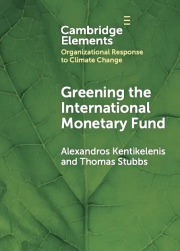
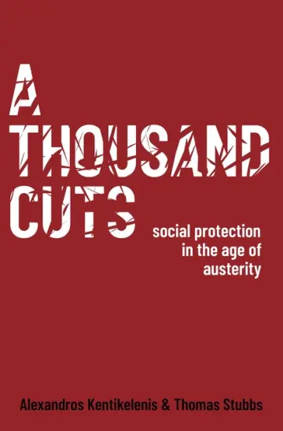

```{r}
#| include: false
# Each book's title, co-author, year, and publisher, and its PDF, DOI, and
# replication-data buttons and "Cited in" lines, come from Zotero
# (R/publications.R). The covers, descriptions, praise, reviews, and
# publishers' pages come from kentikelenis.net, with Alexandros
# Kentikelenis's agreement (decision 18, 10 November 2026); copied
# 11 November 2026. Praise is the four endorsements only, not quotations
# from reviews (Thomas, 11 November). Praise, "Reviewed in", and "Cited in"
# each fold away under their label. No series line under Greening (Thomas,
# 13 November 2026; A Thousand Cuts is in no series).
source("R/publications.R")
```

:::: book
{fig-alt="Cover of Greening the International Monetary Fund" width="180" height="251"}

::: book-body
```{r}
#| output: asis
book_header("XQ7NW3ZS",
  publisher = "https://www.cambridge.org/core_title/gb/626425")
```

The IMF has emerged as a key player in climate policy, and this closer engagement with the economic dimensions of climate change holds the promise of helping countries preempt large-scale economic dislocations from climate risks. But how much progress has the IMF made in supporting the green transition and what is the policy track record of its climate loans and policy advice? Based on extensive new evidence, *Greening the International Monetary Fund* points to the multifaceted, and at times contradictory, ways green transition objectives have become embedded within IMF activities.

```{r}
#| output: asis
book_cited("XQ7NW3ZS")
```
:::
::::

:::: book
{fig-alt="Cover of A Thousand Cuts" width="180" height="274"}

::: book-body
```{r}
#| output: asis
book_header("JIIEA2SM",
  publisher = "https://global.oup.com/academic/product/a-thousand-cuts-9780190637736")
```

*A Thousand Cuts: Social Protection in the Age of Austerity* provides a comprehensive analysis of IMF policies around the world. Based on novel data from the IMF archives, the book offers a replicable database of all IMF-mandated reforms from 1980–2019, and examines their effects on social policies and outcomes. The analysis reveals that although the precise content of IMF-mandated austerity has changed, the organisation continues to place a high burden of reform on its borrowers. These reforms decrease the availability of important social services and contribute to rises in income inequality and declines in population health.

<details class="book-fold">
<summary>Praise</summary>

> “*A Thousand Cuts* is the most significant piece of research on austerity’s pernicious effects in the Global South. Alexandros Kentikelenis and Thomas Stubbs meticulously demonstrate that budget cuts fail poorer countries time and time again. This is essential reading for anyone concerned with how the world can avoid economic mistakes of the past, and how governments can implement policies that promote social protection.”
>
> Mark Blyth, The William R. Rhodes ’57 Professor of International Economics, Brown University

> “This carefully researched book examines more than 6,000 IMF loan documents over four decades to show convincingly that IMF conditionalities still require regressive public policies that in turn have regressive socio-economic outcomes. Such an important book must be read carefully in every national capital, and most of all in Washington, D.C. It forms the basis for arguments for major change if the IMF is to be fit for purpose in the contemporary world economy.”
>
> Jayati Ghosh, Professor of Economics, University of Massachusetts Amherst

> “In brilliant, novel detail, *A Thousand Cuts* provides a devastating indictment of the IMF’s austerity-driven conditionality and its systemic undermining of social policies and outcomes. It should be required reading not just for scholars and policy activists, but also for IMF staff intent on substantively changing the institution’s practices.”
>
> Daniela Gabor, Professor of Economics, School of Oriental and African Studies

> “*A Thousand Cuts* is the first comprehensive, data-driven analysis of the outcomes of IMF lending policies. While the methodology is rigorous and writing style elegant, the conclusions are not pretty. Kentikelenis and Stubbs document the consistently devastating social consequences of ill-conceived austerity measures by the IMF. This truly original and alarming new volume is mandatory reading for anyone interested in how to build a more progressive global economic governance based on evidence over ideology.”
>
> Kevin P. Gallagher, Director of the Global Development Policy Center, Boston University

</details>

<details class="book-fold">
<summary>Reviewed in</summary>

- [International Affairs](https://doi.org/10.1093/ia/iiae111)
- [Journal of Development Studies](https://doi.org/10.1080/00220388.2024.2350777)
- [Economic Record](https://doi.org/10.1111/1475-4932.12825)
- [Liverpool Law Review](https://doi.org/10.1007/s10991-024-09375-9)
- [Portal für Politikwissenschaft](https://www.pw-portal.de/demokratie-und-frieden/ueberblick/alexandros-kentikelenis-thomas-stubbs-a-thousand-cuts-social-protection-in-the-age-of-austerity)

</details>

```{r}
#| output: asis
book_cited("JIIEA2SM")
```
:::
::::
